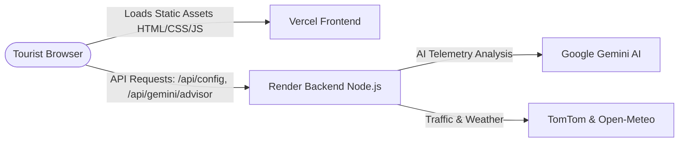

# 🚀 NoRush Deployment Guide (Vercel Frontend + Render Backend)

This document contains step-by-step instructions to manually deploy the **NoRush Smart Tourism Intelligence Engine**.

---

## 🏗️ Architecture Overview



- **Frontend (Vercel)**: Serves `app/index.html`, `app/style.css`, `app/app.js`, `app/data.js` with instant CDN delivery and clean URLs.
- **Backend (Render)**: High-speed, zero-dependency Node.js server (`server.js`) handling dynamic `PORT`, universal CORS, API keys, and automatic multi-key failover for Google Gemini.

---

## 1️⃣ Deploy Backend on Render (Deploy This First)

### Step 1: Log in to Render
1. Go to [https://render.com](https://render.com) and log in with your GitHub account.

### Step 2: Create a New Web Service
1. On your Render Dashboard, click **New +** > **Web Service**.
2. Select **Build and deploy from a Git repository**.
3. Choose your repository: `Tourism` (or your repo name) and click **Connect**.

### Step 3: Configure Settings
Fill in the following exact settings:
- **Name**: `norush-tourism-backend` *(or any unique name you prefer)*
- **Region**: Choose the closest region (e.g. `Singapore` or `Frankfurt`)
- **Branch**: `main`
- **Root Directory**: *(Leave empty)*
- **Runtime**: `Node`
- **Build Command**: `npm install --production`
- **Start Command**: `node server.js`
- **Instance Type**: `Free`

### Step 4: Add Environment Variables
Scroll down to **Environment Variables** (or click the "Advanced" tab) and add the following 4 keys:

| Key | Value | Description |
|---|---|---|
| `GEMINI_API_KEY` | *(Your Primary Gemini Key)* | Primary AI intelligence key |
| `GEMINI_API_KEY_BACKUP` | *(Your Backup Gemini Key)* | Failover key if quota runs out |
| `UNSPLASH_ACCESS_KEY` | *(Your Unsplash API Key)* | Destination high-res imagery |
| `BESTTIME_API_KEY` | *(Your BestTime Key, if any)* | Venue footfall telemetry |

### Step 5: Click Deploy
1. Click **Create Web Service**.
2. Wait 1-2 minutes for Render to start the container.
3. Once live, Render gives you a URL like:
   `https://norush-tourism-backend.onrender.com`
4. Test it by opening in your browser:
   `https://norush-tourism-backend.onrender.com/api/health`
   *(It should respond with: `{"status":"ok","service":"NoRush Backend Engine"}`)*

---

## 2️⃣ Connect Frontend with Backend URL

Once you have your Render URL (e.g. `https://norush-tourism-backend.onrender.com`), you have **two easy ways** to connect the frontend to it:

### Option A (Recommended via `vercel.json`):
Open `vercel.json` and ensure line 27 matches your actual Render URL:
```json
"rewrites": [
  {
    "source": "/api/:path*",
    "destination": "https://<YOUR-RENDER-SERVICE-NAME>.onrender.com/api/:path*"
  }
]
```

### Option B (Instant Dynamic Link):
You don't even need to edit files! Just open your deployed Vercel site in your browser with the URL parameter:
`https://your-frontend.vercel.app/?backendUrl=https://your-backend.onrender.com`
The app automatically saves the backend URL into `localStorage`!

---

## 3️⃣ Deploy Frontend on Vercel

### Step 1: Log in to Vercel
1. Go to [https://vercel.com](https://vercel.com) and log in with GitHub.

### Step 2: Import Project
1. In the Vercel Dashboard, click **Add New...** > **Project**.
2. Select your `Tourism` repository and click **Import**.

### Step 3: Configure Project Settings
1. **Framework Preset**: Select **Other**.
2. **Root Directory**: Click "Edit" and choose **`app`** (or leave `./` since `vercel.json` already defines `"outputDirectory": "app"`).
3. **Build Command**: *(Leave empty)*
4. **Output Directory**: `app` *(automatically detected by `vercel.json`)*
5. **Install Command**: *(Leave empty)*

### Step 4: Deploy
1. Click **Deploy**.
2. Within 15-30 seconds, Vercel will complete the build and show the live production domain (e.g. `https://tourism-garv.vercel.app`).
3. Click the live preview link to test the full website!

---

## 4️⃣ Verification Checklist

After deploying both:
- [ ] Open the Vercel URL in your browser.
- [ ] Ensure Pan-India Heat Overlay map and monument cards render with images.
- [ ] Click on **Taj Mahal** or **Amer Fort** card.
- [ ] Verify the **"Google Gemini Live Situational Briefing"** card loads and provides AI travel advice.
- [ ] Click **"Test Rain Re-plan"** to verify the real-time weather disruption rerouting.
- [ ] Open **"Judge Playbook (12 Q&As)"** from the navbar to verify all technical defenses are intact.

